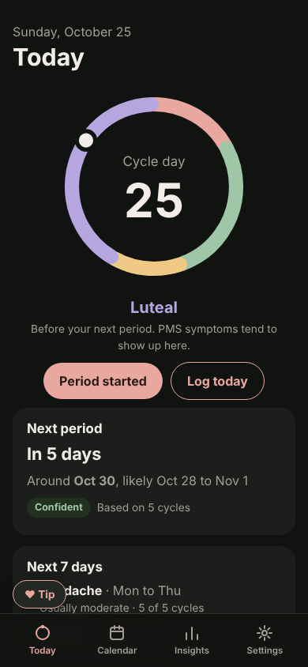
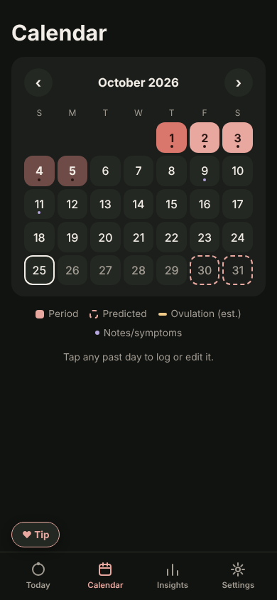
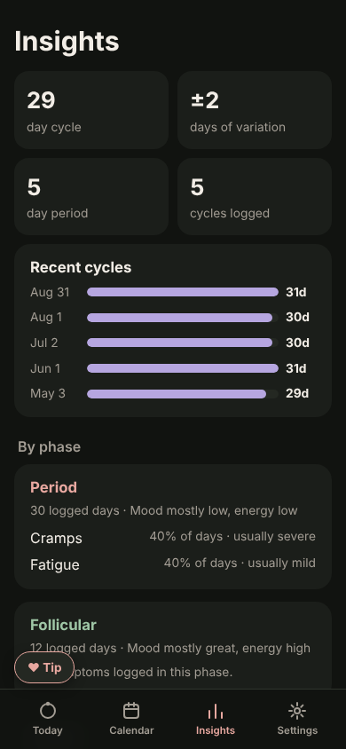

<p align="center">
  
</p>

<h1 align="center">Orbit</h1>

<p align="center">
  <b>A period tracker that physically can't spy on you.</b><br>
  No account. No server. No analytics. Your data never leaves your phone, and the code is here so you can check.
</p>

<p align="center">
  <a href="https://just-f1zzy.github.io/Orbit/">Open the app</a> ·
  <a href="#install">Install</a> ·
  <a href="#how-the-privacy-works">How the privacy works</a> ·
  <a href="https://ko-fi.com/YOUR-KOFI">Support</a>
</p>

<!-- Screenshots: replace with real ones. 3 is plenty. -->
<p align="center">
  
  
  
</p>

> **Status: early development.** Storage, offline install, and export/import work now. The logging screens and predictions are being built next.

---

## Why this exists

After Roe v. Wade was overturned, a lot of people stopped trusting period apps, and with good reason. Many of the big ones collected cycle data on their servers, shared it with advertisers or analytics companies, and some of that data can be requested by courts.

Orbit fixes that with how it's built, not with a promise. There's no Orbit server, so there's nothing to sell, leak, hack, or subpoena. If you want to know whether that's true, read the code or get a technical friend to.

## What it does (planned for v1)

- **Log your cycle.** Period days, flow, symptoms, mood, energy, and notes.
- **See where you are.** The app shows your current phase (menstrual, follicular, ovulation window, luteal) and how many days are left.
- **Predictions that learn you.** For the first few cycles Orbit uses typical averages. As you log more, it adjusts to *your* cycle length, how much it varies, and which symptoms usually show up when, and how bad they tend to get.
- **Honest confidence.** Every prediction shows how sure it is. Three logged cycles give a rough guess, and a year of logs gives a much better one. It never pretends to know more than it does.
- **Export and back up.** Download your data as a file anytime. You own it, so you can move it, back it up, or delete it.
- **Works offline.** Once it's installed you don't need internet at all.

## How the privacy works

| Claim | How you can verify it |
|---|---|
| Your data stays on your device | All data is stored in your browser's local storage (IndexedDB) on your phone. Search the code for `fetch(` and you'll find nothing that sends your data anywhere. |
| No analytics or trackers | No Google Analytics, no Firebase, no ad SDKs, no crash reporters. See `package.json` for every dependency. |
| No third-party requests | Fonts and icons are bundled with the app. A Content-Security-Policy blocks the app from contacting other servers, even by mistake. |
| No account | There's no sign-up, so no email, name, or password is ever collected. |
| Open source | The whole app is in this repo under the GPL-3.0 license. Anyone can audit, fork, or build it themselves. |

**One honest limit:** because your data only lives on your phone, if you lose the phone or clear the browser data without exporting first, it's gone. Nobody, including me, can recover it. Use **Settings → Export** now and then.

## Install

Orbit is a web app you install to your home screen. It's free, there's no app store fee, and you don't need an account.

**Android (Chrome, Brave, Firefox):** open the link above, tap the menu, then **Install app** or **Add to Home screen**.

**iPhone / iPad (Safari):** open the link above, tap **Share**, then **Add to Home Screen**.
> Install it to the home screen, don't just bookmark it. Safari can delete website data that hasn't been used in 7 days, but home-screen apps are protected from that.

**F-Droid:** coming soon.

## Not medical advice. Not birth control.

Orbit is a logging and pattern tool. Its predictions are **estimates** from your past entries, and bodies don't always follow patterns.

- **Do not use Orbit to prevent pregnancy.** "Safe day" or fertile-window estimates aren't reliable contraception.
- It can't diagnose anything. If your cycle changes suddenly, or pain, bleeding, or mood symptoms get worse, talk to a doctor or nurse.

## Who made this

I'm Hunter, a student who's into cybersecurity and building useful health tools. I'm a guy, which is exactly why Orbit is built so you don't have to trust me: I never see your data, and the code proves it.

Orbit was shaped by feedback from women who tested it before launch. If something feels off, unclear, or missing, [open an issue](../../issues). That feedback matters more than anything else.

## Build it yourself

```bash
git clone https://github.com/JUST-F1ZZY/Orbit.git
cd orbit
npm install
npm run dev      # local dev server
npm run build    # production build in dist/
```

## Contributing

Bug reports, design feedback, translations, and code are all welcome. One hard rule: **no PR that adds network calls, analytics, or third-party SDKs will be merged.** That's the whole point of the app.

## Support

Orbit is free and will stay free, with no ads, no premium tier, and no data deals. If it helped you and you want to say thanks, you can [buy me a coffee on Ko-fi](https://ko-fi.com/YOUR-KOFI). Totally optional.

## License

[GPL-3.0](LICENSE). You can use, change, and share it, but any version you distribute has to stay open source too. Nobody can take this code and turn it into a closed app that sells data.
